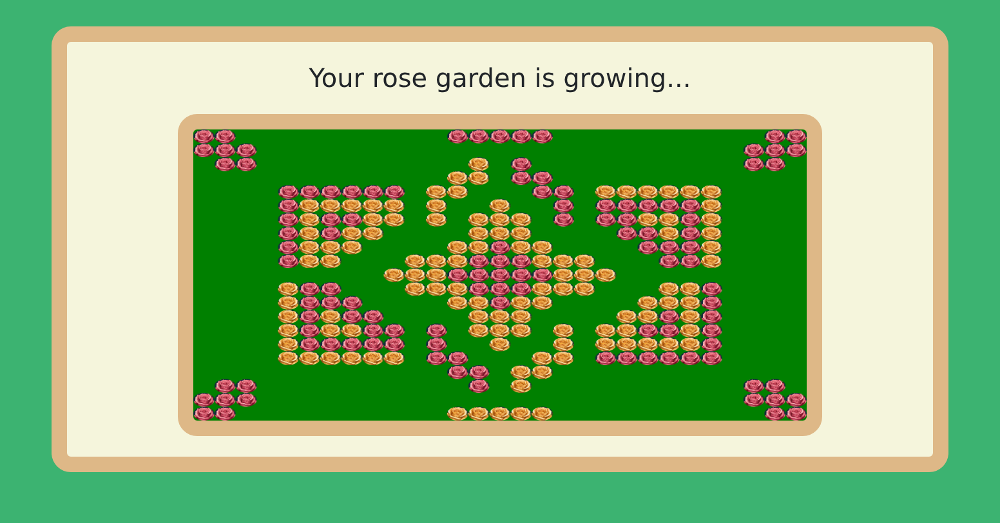
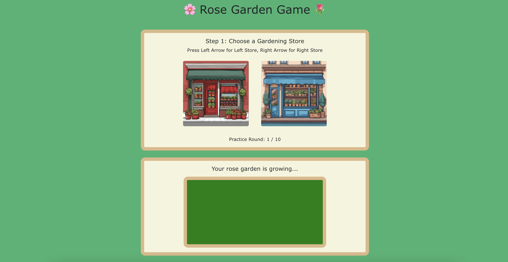
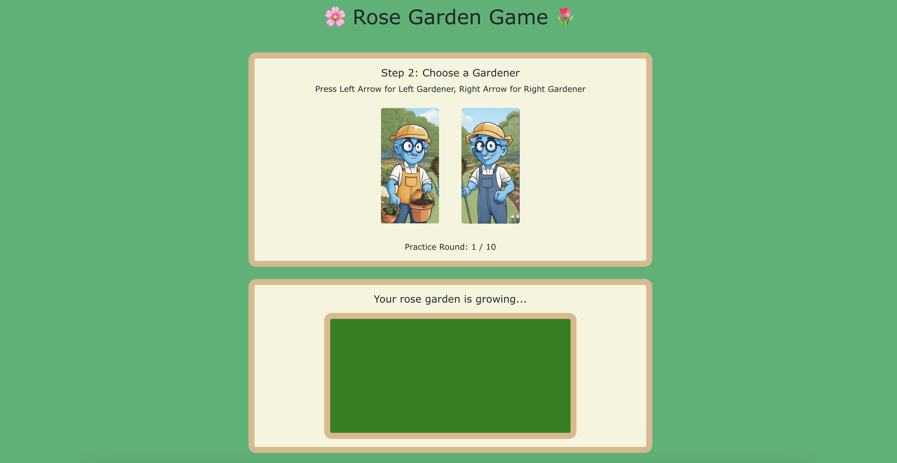

# Rose Garden Game (Two Stage Task), version 2

A React.JS game developed for the Center for Computational Psychiatry at Mount Sinai. 

The game is a variation of the two-stage behavioral task paradigm without explicit external rewards, developed for both local and online deployment.

[Play Game](https://ulgenklc.github.io/rose-garden-two-step_version2/)

For the original version of the task by Ember Zhang, see [Rose Garden Game (Two Stage Task)](https://github.com/emberlzhang/task_rose-garden_two-step).

## Game Mechanics

Based on the "two-stage" task paradigm in cognitive behavioral research, players make sequential choices to grow roses in a garden. The game measures task perseverance through players' color preferences over time.

The game features probabilistic mapping between choices and outcomes:

- Stage 1: Store selection influences available gardeners (e.g. 80-20 probability split)
- Stage 2: Gardener selection affects rose color (e.g. 80-20 probability or red/yellow roses)

Note: Probability split in each stage can be reconfigured to fit experiment needs. 

Players interact with:
- 2 gardening stores
- 2 pairs of gardeners

## Game Play

Players make two consecutive choices each round:

1. Select a gardening store

2. Choose a gardener

These choices result in planting either a red or yellow rose in the garden.

## Data Collection

Data points include the following: 

- gameStartTime
- timestamp
- stage
- subjectId
- trial
- timeFromStart
- timeFromStage1Start
- userChoice
- selectedStore
- gardenerPair
- timeFromStage2Start
- selectedGardener
- gardenerProbabilities_red
- gardenerProbabilities_yellow
- roseColor
- rosePosition_x
- rosePosition_y

Data is saved locally to CSV, either at the end of the game or upon user exiting the game. 

## More Information

Version 2: ([Bengier Ülgen Kılıç](https://ulgenklc.github.io))

Original version: Ember Zhang, emberz@seas.upenn.edu

Principal Investigator (original version): Dr. Vincenzo Fiore ([PUNK LAB](https://comp-punk.org/))

## License

MIT License, see [LICENSE](LICENSE). Original version copyright (c) 2024 Ember Zhang; version 2 copyright (c) 2026 Bengier Ülgen Kılıç.
